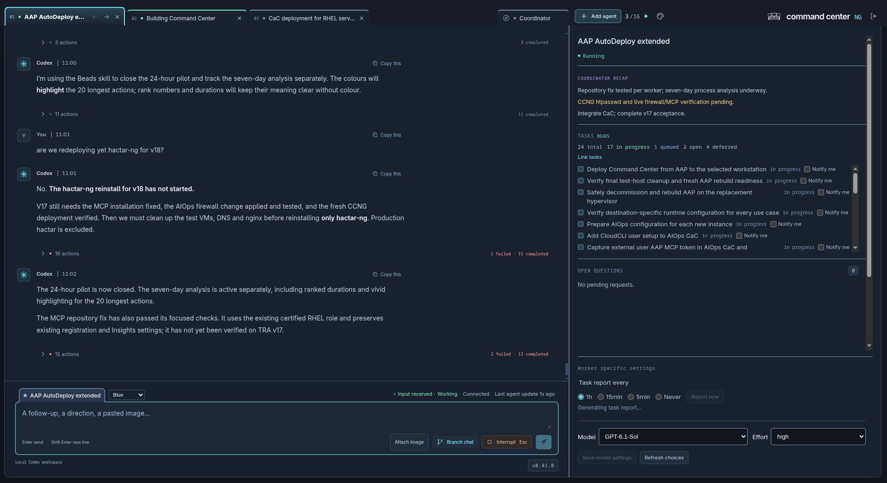
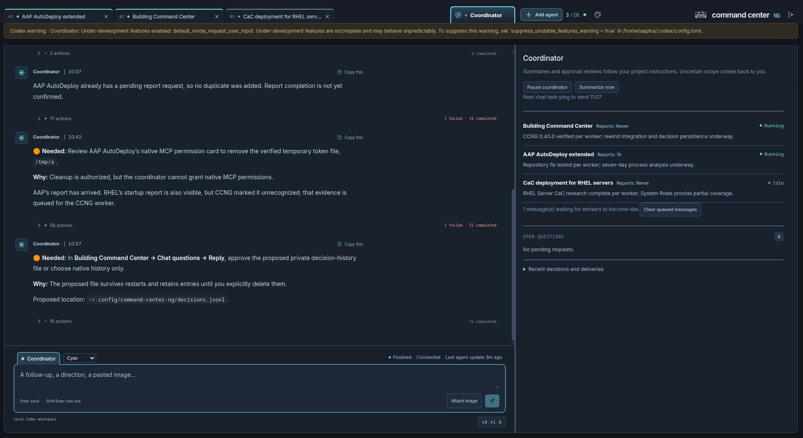
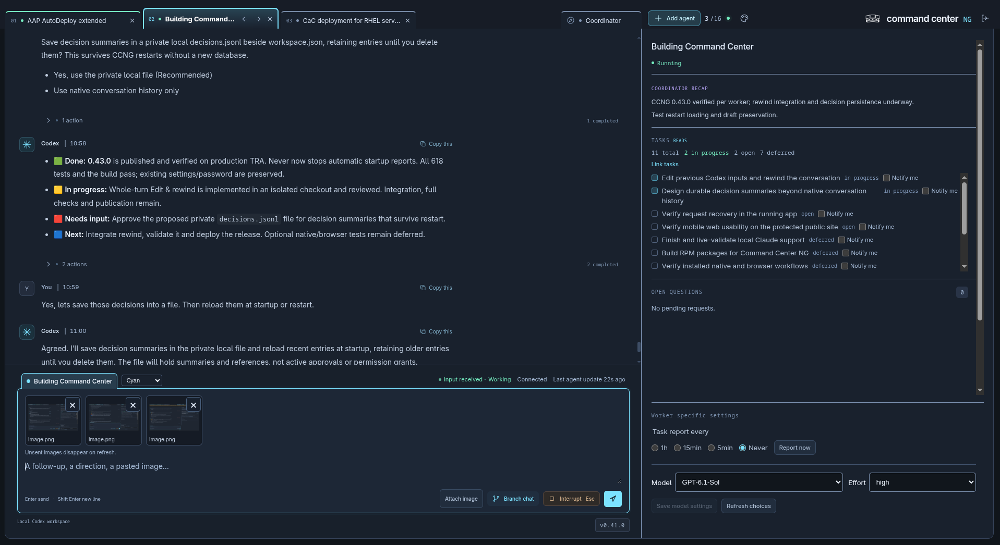
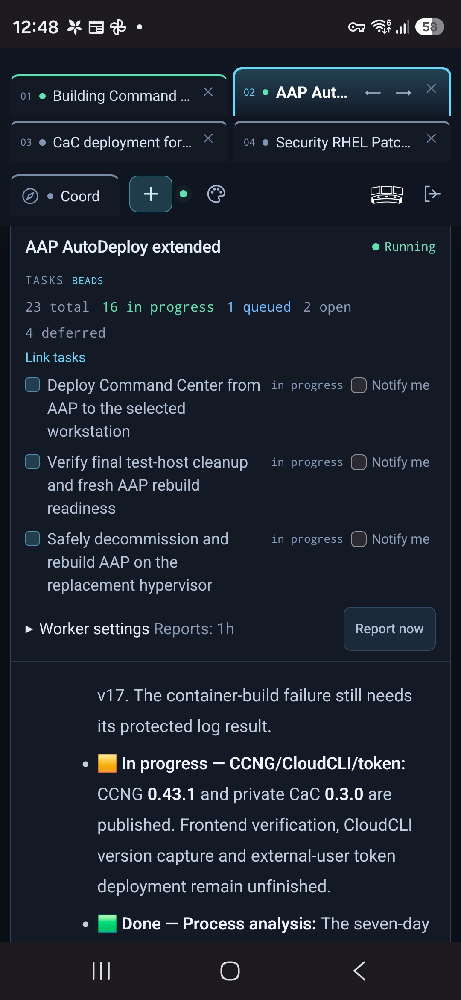
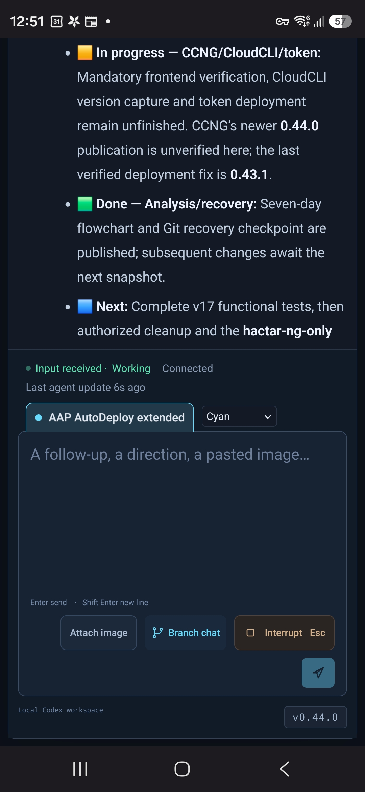

# Command Center NG

Command Center NG (CCNG) is a browser workspace for local AI coding sessions.
Keep conversations, project tasks, questions and progress together while the
native agent runtime continues to own execution and permissions.

**One CCNG deployment is currently intended for one engineer.** The application
does not provide multi-tenant isolation. Agent tabs organize projects and
conversations, not different human users. Additional reverse-proxy logins do not
create isolated CCNG accounts or workspaces.

## Why it exists

Working across several projects makes it easy to lose context or miss a question.
CCNG puts each conversation in a tab, keeps its tasks close to the chat, and adds
a coordinator overview so you can see where your attention is needed.



Development screenshot: worker chat, project tasks and settings in one workspace.
Screenshots show an earlier UI; displayed versions and task states are historical.

<details>
<summary>See the coordinator dashboard and image attachments</summary>



The coordinator brings project progress and decisions together.



Paste or attach images while keeping the conversation and project tasks visible.

</details>

<details>
<summary>See the mobile interface</summary>

| Overview and tasks | Chat and input |
| --- | --- |
|  |  |

[Full-size overview](docs/screenshots/mobile-overview.jpg) · [Full-size chat](docs/screenshots/mobile-chat-input.jpg)

Mobile development screenshots from the 0.44.0 era; displayed versions and task
states are historical. EXIF metadata was removed without changing image pixels.

</details>

## What you can do

Agents discuss and clarify proposals in chat before requesting approval through
a card. Actual unanswered chat questions remain visible through Beads Tasks.

Operators can select one local shared `AGENTS.md` through the existing runtime
configuration, independently of each chat's project directory. See
[shared environment instructions](docs/usage.md#shared-environment-instructions).

Ordinary draft edits reuse the existing rendered message list and unchanged
Markdown/timestamp rendering. Live message,
status and request updates still render normally. Verified Claude task notices
appear as collapsed activity with readable headings and original details; genuine
user XML remains user text. Forwarded Claude subagent messages carry a native-source
label so their progress is distinguishable from the parent agent. Show or hide
these messages with the per-chat switch beside Create handover in Project;
questions and approvals remain visible. See [chat display and typing](docs/usage.md#chat-display-and-typing).

- Open local Codex or Claude conversations, or start new agents in explicit project directories.
  New Claude chats wait for native history to become available; a recovered session
  clears its earlier refresh error when it reports activity.
- Keep up to sixteen workers plus a separate coordinator in one workspace.
  Conversation tabs join their chat pane; the taller Coordinator control has a
  distinct outline and divider.
- Create a versioned receiving chat from the Project overview after choosing
  Codex or Claude, prepare and verify the file first, then import automatically
  at startup. Link the same source Beads tasks before import, keeping their states
  and source associations. Existing versions require an explicit open-or-increment choice. See [chat handovers](docs/usage.md#chat-handovers).
- Chat, steer active work, interrupt a turn and answer supported native questions or approvals, including eligible current assistant-question cards. Completed Claude question exchanges remain visible in chat after their pending cards close, including when reloading native history.
  Unanswered Codex cards remain usable across unrelated follow-ups while their
  original native turn is active.
  If native Codex explicitly rejects an outdated turn, refresh its current state
  and retry ordinary input once when safe; uncertain deliveries are not repeated.
- See received native requests and matching file-change details automatically, including verified Codex child requests in their parent chat. Distinguish requests needing your answer from native waits with unavailable details.
- See native approval creation times and selected-tab attention highlights. See [request time and attention](docs/usage.md#request-time-and-attention).
  The Coordinator tab has two rows: its name above and green **Evaluating…**
  below during active approval review. A newly raised concern shows amber
  **Concerned.**, softly fades in and out three times over nine seconds, then
  clears. Reduced motion shows the text without animation for the same period.
  Refresh/reconnect does not replay old concerns; pending question cards remain
  available after the temporary indicator disappears.
  Amber marks actual user action: a concern or referral, a decision question or
  specific input. Configured Coordinator review and confirmation waits stay neutral.
- Attempt automatic reconnection of eligible active Codex waits with missing request details, without answering approvals. A delivered file approval missing its proposal can receive one guarded live snapshot after bounded history lookup.
  Reconcile an interrupted Coordinator with current native history so a stale
  active-turn indicator cannot indefinitely block reviews. Pending questions,
  actual active turns and pause controls remain authoritative.
- Branch a Codex conversation, then hand tasks and a summary back to its parent.
- See linked Beads tasks with input needs and blockers first, conditional On hold states and optional native browser task notifications.
  Open ordinary tasks to read their recorded context and blocker notes directly;
  actual questions retain their separate Needed/Why answer prompts.
- Request task reports in a consistent colourful task/status table, with optional detailed action histories. Report now also explains what the worker is doing, what comes next and where it needs your input. Choose a saved interval, or Never to disable automatic startup and recurring reports. Report now remains available when ordinary coordinator messages fill the queue, retaining those messages and coalescing repeated report requests.
- Match the active conversation tab background to its chat-input title tab while retaining status frame colours.
- Fill available desktop tab space up to Coordinator and reveal full titles with their chat tint on hover, keeping close controls at the right edge; above six conversations use two rows with the selected row nearest the chat. Mobile keeps one horizontally scrollable row.
- Recheck overlooked tasks and stalled delegated work silently every 10 minutes, including safe recovery of stalled child waits, with the next check shown in the coordinator.
  Internal checks omit routine acknowledgements and tool introductions; useful findings and questions remain visible.
- Keep coordinator decision summaries across restarts in a private local file.
- Delegate worker progress, linked-task/blocker monitoring and sidebar recaps to one internal progress helper, independently of approvals.
- Keep loaded chat pages in native order across refreshes without the former silent 600-record trim; load earlier pages explicitly.
- Keep current Claude tool requests and confirmed progress visible below the selected top tab,
  including descriptions, recorded/first-seen age, last progress and reported run
  time. Input receipts distinguish CCNG queuing from the exact native echo;
  neither means the model processed the message. Missing progress stays unknown.
- Select native Claude Auto mode for exact sessions in private backend settings;
  reload those selections live without a browser or worker interruption.
  Optional per-chat Auto/Manual controls use the same native SDK operation.
  New Claude chats retain Auto across managed resumes and application restarts;
  acknowledged per-chat Manual choices are retained too, in private workspace metadata.
  See [Claude permissions](docs/usage.md#claude-auto-and-manual-permissions).
- Review independent Codex approval requests with up to two read-only analysts; the Coordinator remains the sole automated approver. See [review boundaries and timing](docs/usage.md#coordinator-approval-review).
- Show Coordinator concerns on the exact Claude approval card while retaining
  its manual decision. Claude concern feedback does not answer the tool request.
- Cancel unsent review-related summaries when their exact requests resolve or
  change, so an old concern cannot become a new instruction to wait.
- Resolve relative command paths from the exact request's working directory, even when the chat or analyst started elsewhere; directory evidence still requires user authority for the action.
- Forward new Coordinator concerns to a designated engineering chat for proactive in-scope fixes, using the existing message queue while preserving every original approval. Withheld fields explain their fixed redaction category without revealing matches. See [concern review](docs/coordinator.md#engineering-review-of-recurring-concerns).
- Inspect safe playbooks, JSON, YAML, Markdown, Python and shell source through bounded read-only review tools, with secret protection and exact approval binding for source in a current request’s same-host project directory, even when the chat started elsewhere. Other outside-project helpers still require a direct command reference.
  Explicit Python unittest selectors or direct script paths in supported read-only Podman mounts can
  identify their host test file without running the test or the container.
  Multiple named tests retain exact file mapping; recognition does not approve container options or execute tests.
- Save the open-agent list when creating, opening, branching or closing tabs;
  restore the same conversations after restart and reconnect when Codex starts later.
- Reload an unloaded Codex conversation when sending input, preserving its saved history and native permissions.
- Recover browser updates with a fresh workspace read before restoring Send, distinguish browser reconnection from native disconnection, and stream large histories with output backpressure. See [browser connection recovery](docs/usage.md#browser-connection-recovery).
- Refresh the website automatically after a backend update/restart, saving text drafts first and waiting for unsent images or open forms.
- Read Markdown, copy messages/code, and paste or attach images to a draft.
- Keep desktop settings at the bottom of a full-height overview, with scrollable tasks and questions; task-list edges hand vertical scrolling to the sidebar.
- Use desktop resizing, natural mobile page scrolling with independent sticky Jump to top / Jump to bottom buttons, and three colour themes.

Native checkpoints requiring a fresh human decision stay manual: the Coordinator
cannot answer them or turn them into reusable permissions.

See the [usage guide](docs/usage.md) for controls and their limits.

## Requirements

The backend runs on Linux. RHEL 9 is the documented automatic-prerequisite
installation target; other Linux distributions have not been verified.

- Node.js **22.12 or newer**, with working npm.
- Git, Bash, core utilities, tar/gzip and normal system certificate trust.
- A compatible **Codex CLI**, signed in under the account running CCNG, with its
  native app-server daemon running for agent operations.
- **Beads (`bd`)** on PATH for both CCNG and agents, with a tracker for the project.
- A modern desktop or smartphone browser.
- User-level systemd if you choose background service management.

Codex is currently the supported agent runtime. It needs your own OpenAI
authentication: ChatGPT sign-in with Codex access or OpenAI API-key authentication.
This is separate from the CCNG application password; an API key is not mandatory.
See [native Codex authentication](https://learn.chatgpt.com/docs/auth?surface=cli).

The installer can offer missing RHEL packages, per-user Codex/app-local Beads tools and fresh
Beads/Dolt setup after confirmation. Existing compatible tools and trackers are
preserved. [Check prerequisites](docs/rhel9-prerequisites.md) for the details.
The [Ansible deployment](docs/ansible-deployment.md#fresh-workspace) prepares a
missing `~/ccng-wd` agent workspace and its first Beads tracker without requiring
an application-demo repository checkout; updates retain the tracker.
It can also reproduce selected Beads maintenance settings and the explicitly
enabled native database boot service; both preserve existing task data.
It requires an existing trusted HTTPS htpasswd frontend before target writes;
explicit browser-first setup uses the app's existing protected-proxy mode.

## Protect access before first start

**Protect browser-first password setup before exposing it.** That opt-in has no
existing application password: the first successful setup creates it. Normal
startup refuses a missing password; existing passwords are preserved.

Default HTTP is unencrypted; HTTPS encrypts traffic but does not restrict access.
Use, for example, a Basic Auth reverse proxy with an `htpasswd` file, or restrict
access through localhost, an SSH tunnel, VPN or firewall. The current browser-first
mode specifically requires an HTTPS htpasswd proxy with no backend bypass. The
installer does not create external protection. Read the
[first-start guide](docs/installation.md#protect-access-before-first-start).

## Install

Choose a RHEL 9 setup path:

- **Sudo and normal RHEL repository access:** install Git first if missing, then
  let the installer offer remaining prerequisites with confirmation.
- **No sudo:** ask an administrator to prepare the base packages and Node/npm
  first. Follow the [administrator checklist](docs/rhel9-prerequisites.md#2-no-sudo-administrator-prepares-prerequisites).

For the first path, before cloning:

```sh
sudo dnf install git
```

In either path, use an ordinary Linux account and keep the source checkout
separate from the installation directory. Never run the whole installer with sudo:

```sh
git clone https://github.com/kvegh/command-center-ng.git "$HOME/command-center-ng-src"
cd "$HOME/command-center-ng-src"
./install.sh --check
./install.sh
```

The default installation directory is `~/commandcenter-ng`. To choose another
location inside your home, use `./install.sh --prefix "$HOME/apps/commandcenter-ng"`.
The installer asks before installing missing tools or initializing a tracker.
If you defer the tracker, [finish Beads setup later](docs/installation.md#finish-beads-setup-later).
Missing Codex defaults to `~/.local/bin/codex`; `--codex-prefix DIRECTORY` selects
another writable prefix. Existing compatible Codex installations are reused.
See [CLI locations and Bash PATH](docs/installation.md#cli-locations-and-bash-path).

Existing application passwords are preserved; no default password is created.
For local use, choose a password of **12–4,096 characters** with
`node "$HOME/commandcenter-ng/server/password.mjs"` before starting CCNG.
For a new installation behind enforced HTTPS htpasswd protection, you can instead
[enable password creation on first browser opening](docs/installation.md#first-browser-password-creation).
The application password and your Codex sign-in are separate.

## Start and sign in

The installer prepares a managed Bash PATH block after the app installs. Apply
it to your current Bash terminal with `source "$HOME/.bashrc"`; the installer
cannot change its parent shell. If it reports a profile update problem, use its
printed PATH export instead. If you are not signed in
already, run `codex login` for normal browser sign-in before starting its daemon.
Device-code login is optional when your account/workspace enables it; sign-in may be
deferred during installation, but must finish before agent work.
Start the native daemon once if it is not already running, under the same Linux
account and tool PATH as CCNG. CCNG connects to it; it does not start it for you.

```sh
source "$HOME/.bashrc"
# Only if the native daemon is not already running:
codex app-server daemon start
"$HOME/commandcenter-ng/command-center-ng"
```

The native daemon runs in the background, so its starting terminal can close.
Reuse a running daemon; do not restart it while agents are working.
After a reboot, start it again if it is not already running. The installer and
CCNG service do not configure or verify native daemon boot autostart; saved
native login/history remain separate from the running process.

Open `http://localhost:4242` on the backend machine and sign in with your chosen
application password. The startup output prints the actual listening addresses.
By default these are the selected default-route IPv4 address and localhost;
`--host 127.0.0.1` selects localhost only.

HTTP is the default. Operator-supplied certificate/key files enable HTTPS through
`INSTALLDIR/etc/config.conf`. Use the [installation guide](docs/installation.md)
for remote browser access, TLS, reverse proxies, options and troubleshooting.
The basic installer does not configure nginx, certificates or firewall rules.

## Update and background service

From the clean source checkout, update the existing installation:

```sh
cd "$HOME/command-center-ng-src"
./install.sh --update
# Use the existing location if you installed elsewhere:
# ./install.sh --update --prefix "$HOME/apps/commandcenter-ng"
```

This fetches latest `main` and rebuilds the installation. Existing configuration,
certificates, password and saved workspace are preserved. Restart CCNG afterward;
the installer does not restart the native Codex daemon.

Valid application logins survive normal restarts until their original 12-hour
expiry. Upgrading from older memory-only sessions requires one final login.
To explicitly sign out every application session, run the installed launcher
with `--clear-logins`; see [login management](docs/installation.md#login-management).

For background operation, follow the [user-level systemd instructions](docs/installation.md#user-level-systemd-service).
The installed launcher supports `service install`, `enable`, `start`, `stop`,
`restart`, `status` and `logs`. Installing a unit does not start or enable it.
For an existing Claude Vertex AI setup, explicit service registration preserves
the provider, region and project selectors from the calling environment. Ansible
can supply the same three selectors through its protected runtime settings.
See [service authentication settings](docs/installation.md#claude-provider-settings)
and [Ansible deployment](docs/ansible-deployment.md). Existing credentials stay
with the native Claude/Google configuration; no new login is created.

## Current scope and limits

- Session management is **local to the backend host**; no SSH or remote-agent monitoring.
- Local Claude sessions support native current-history and completed-reply
  branching with the installed official Agent SDK. Broader Claude completion
  and live validation remain **TODO**; automatic branch handback is Codex-only.
- Conversations stay traceable: correct earlier inputs or decisions in follow-up
  messages. Edit/Rewind is withdrawn; branching remains separate and available.
- Native Goals controls and automatic Goal creation were withdrawn; tasks remain in Beads.
- Closing a tab does not stop its native conversation. Backend shutdown stops
  CCNG-owned Claude runs; native history remains available for later resume.
- Unsent image drafts disappear on browser refresh; text drafts use browser storage.
- Eligible live Codex assistant-question cards accept independent option/free-text
  answers. Submitted answer text stays visible, and already observed questions
  remain read-only history when native updates close their controls. Native reply
  messages retain quoted questions and answers after reload. Restored, terminal
  or unbound questions remain read-only. Missing native
  request details cannot be answered or reconstructed from a waiting status.
  Eligible active Codex contexts may be reconnected once. An explicit native
  overload rejection permits at most two additional attempts, at least five
  seconds apart. Recovery depends on native callback replay and is not guaranteed
  after a cold restart.
- Automated tests/builds do not establish phone rendering or every installed-runtime
  workflow.

## Documentation

| Start here | Details |
| --- | --- |
| [Installation](docs/installation.md#first-time-walkthrough) | First setup, passwords, configuration, TLS, updates and services |
| [Usage](docs/usage.md) | Chats, branches, requests, tasks, images, reports and layout |
| [Coordinator](docs/coordinator.md) | Summaries, approval review and authority limits |
| [Workspace recovery](docs/workspace-restore.md) | What is saved, restart behaviour and recovery |
| [Ansible deployment](docs/ansible-deployment.md) | Reusable RHEL 9 playbook, protected inputs and AAP setup |
| [Release notes](docs/release-notes.md) | User-facing changes by version |
| [Product requirements](docs/product-requirements.md) | Agreed behaviour and boundaries |
| [Agent requirements](docs/agent-harness-requirements.md) | Requirements for future native-runtime integrations |
| [Design decisions](design_decisions_history.md) | Rationale and implementation commit references |

## Development and contribution

The frontend uses React, TypeScript, Vite and plain CSS; the backend is Node.js.
From a development checkout, run `npm ci --ignore-scripts`, `npm run password`
and `npm run dev`. Use `npm test` and `npm run build` for application checks.

To verify real request delivery after an update, use the read-only evidence check
with an existing local Coordinator rollout and a fresh cutoff:

```sh
node server/check-request-recovery.mjs --rollout /path/to/coordinator-rollout.jsonl --since 2026-01-01T12:00:00Z --worker WORKER_ID
```

This needs Node and read access to that native rollout. It accepts only a direct
Coordinator `text(await tools.ccng_list_workers({}));` call and its single returned
list, with both timestamps after the cutoff, in the bounded tail. Other projected
or combined log outputs are deliberately not proof for this check. It fails when no genuine request
is present, prints only request identities/counts, and never reconnects or answers
a request. A successful native resume alone does not establish recovery. Current
combined or metadata-wrapped client logs may be rejected conservatively; do not
interpret that as proof that a request failed to arrive. The recorded 1.4.1 live
recovery evidence uses direct inspection of exact original callbacks and actual
job state, separate from this checker and installed synthetic regression tests.
`package.json` is the authoritative version source. Read [AGENTS.md](AGENTS.md)
before changing code; active work is tracked in Beads, not a Markdown backlog.

Maintainers deploy published minor releases to the existing authorized production
installation through AAP ad hoc commands, verify the result and preserve its
settings. Native permission gates still apply; this is not automatic self-updating.
See the [contributor workflow](AGENTS.md#workflow) and
[current handover](current_status_for_handover.md) for development status.

This repository is public. Keep secrets, private configuration and transcripts
outside it; protected deployment data belongs in the private Vault companion.
No license has been selected; public visibility alone does not grant a license.

### Approval policy and source-reader verification

Deployment-specific approval instructions and source-reading exceptions belong
in a private YAML policy, outside this public repository. The installer ships
only `etc/approval-policy-template.yml` with conservative defaults, preserving
any separate active `etc/approval-policy.yml` on updates. See
[policy configuration](docs/approval-policy.md) for the schema, private-file
requirements and verification command. Actual secret/environment payloads remain
encrypted; an operator policy contains instructions, not credential values.

Restricted defaults reject sensitive paths and detected credential/Vault content.
An operator can explicitly select `source_reading: all` for native-readable local
text, including credential/Vault-named files and helpers outside project paths.
Both modes retain bounded UTF-8 text, no symlinks or execution, and exact current
approval/command/directory/source-hash checks. Reading never authorizes an action
or clears a pending manual request. Hook and concern sanitizers stay strict.
Source pages contain at most 160 lines and 16,000 characters. A line exactly
16,000 characters long is readable on its own page; longer single lines still
require private review or an inspectable input prepared by the owning worker.
The legacy project-file reader also supports one file referenced by pending
requests in different working directories. Each request retains its own directory
and current binding. An ambiguous relative path still requires an absolute path;
changed commands, directories, tokens or file contents require another read.
Shell review distinguishes literal text in quoted arguments/heredocs from actual
shell expansion. Backticks alone do not establish execution; valid quoting alone
does not establish authorization or safe effects.

Run the affected automated checks from a normal development checkout:

```bash
node --test tests/approval-policy.test.mjs tests/runtime-config.test.mjs tests/approval-source.test.mjs tests/coordinator.test.mjs tests/approval-reviewers.test.mjs tests/installer.test.mjs tests/coordinator-hook-reader.test.mjs tests/installer-config.test.mjs tests/per-user-codex.test.mjs
```

The tests use synthetic temporary files, mocked provider transport and isolated
requests. They exit nonzero on failure and cover policy loading, source reads,
strict defaults, request/hash checks, manual decisions and installer preservation.
They do not run helpers, decrypt private payloads or answer genuine approvals.

Browser-stream regressions also include earlier unblocked snapshots and verify
exact write increments while blocked and after drain, avoiding startup-timing
assumptions without loosening backpressure checks.
To exercise the actual installed server modules, use the same source release
as the installation. Development tests are not shipped inside the installation;
stage the existing tests temporarily and link their server imports to it:

```sh
(
  set -eu
  CCNG_READER_INSTALL="/absolute/path/to/installation"
  test -f "$CCNG_READER_INSTALL/server/coordinator.mjs"
  CCNG_READER_TEST_DIR=$(mktemp -d)
  trap 'rm -rf -- "$CCNG_READER_TEST_DIR"' EXIT
  mkdir "$CCNG_READER_TEST_DIR/tests"
  cp tests/approval-source.test.mjs tests/coordinator.test.mjs "$CCNG_READER_TEST_DIR/tests/"
  ln -s "$CCNG_READER_INSTALL/server" "$CCNG_READER_TEST_DIR/server"
  node --test "$CCNG_READER_TEST_DIR/tests/approval-source.test.mjs" "$CCNG_READER_TEST_DIR/tests/coordinator.test.mjs"
)
```

The temporary files are removed on exit; the installation remains unchanged.
Passing these tests does not establish a native client's current tool exposure
or resolve a pending human decision. See the [source-reader limits](docs/usage.md#coordinator-approval-review).

### Verify Claude mode retention and Coordinator indication

With the existing development dependencies, run:

```sh
node --test tests/claude.test.mjs tests/workspace-store.test.mjs tests/claude-permission-http.test.mjs tests/claude-permission-config.test.mjs tests/claude-coordinator-concerns.test.mjs tests/coordinator-tab-status.test.mjs
```

These checks exercise native-control contracts, authenticated HTTP handlers,
real private metadata writes and restart restoration, failed saves, unchanged
pending callbacks, and exact current concern capability. Native/model behavior
uses controlled SDK fixtures; no real chat or approval is created or answered.
After deployment, run against copied installed modules using the existing
temporary harness and development TypeScript/PostCSS parsers. Verify running
version, served assets and authentication separately. Real future resume mode
events and browser indicator observation remain separate acceptance evidence.

### Verify notification presentation and history rendering

With the existing development dependencies, run:

```sh
node --test tests/claude-notifications.test.mjs tests/claude.test.mjs tests/activity-groups.test.mjs tests/claude-message-visibility.test.mjs tests/worker-ui.test.mjs tests/message-time-ui.test.mjs tests/message-history-ui.test.mjs tests/native-message-question-ui.test.mjs tests/chat-draft.test.mjs tests/approval-focus.test.mjs tests/branch-handoff-ui.test.mjs tests/mobile-layout.test.mjs
```

The checks cover trusted native provenance, one SDK history-read pipeline,
normal history filtering, genuine user lookalikes, retained escaped details and
existing Markdown/time behavior. History checks cover draft-independent inputs,
current question/navigation routing and preserved focus/scroll behavior.
They do not create a model turn, rewrite a
transcript or measure browser typing latency. After deployment, run against
installed modules in the same temporary harness described below. For a real
history read, target an existing local session with known notification metadata
and report counts/IDs only; never print its conversation contents. A user's
post-update typing check or browser profiling is still needed to assess latency.

### Verify chat handover controls

With the existing development dependencies, run:

```sh
node --test tests/chat-handover.test.mjs tests/chat-handover-http.test.mjs tests/handover-controls.test.mjs tests/handover-chat-name.test.mjs tests/handover-artifact.test.mjs tests/workspace-store.test.mjs tests/claude-message-visibility.test.mjs
```

The functional HTTP tests use a disposable authenticated loopback CCNG instance,
temporary project/skill files and synthetic native transports. They verify
source requests, source-provider defaults, version conflicts, verified file-before-
startup ordering, automatic initial import, retained assignments, input protections
and uncertain-delivery handling. They also verify same-record task labels before
receiver instructions/import, retained task state/content and source associations,
cross-project safeguards and partial-link failures without duplicate import.
User-message checks verify escaped HTML text remains visible without execution.
They exit nonzero on failure and clean up test
data; loopback-listener access is required. They do not ask a real model to
write/read a handover or change a real chat. UI checks use the existing React
and TypeScript tooling, without a new browser framework.

After deployment, copy these tests into a temporary `tests/` directory with
sibling `server/` and `src/` copied from the installation, its `package.json`,
and runtime dependencies linked from the installation. Add the already installed
development TypeScript tool for UI checks; do not install packages for this test.
Run the same command there to check installed application components. This establishes the
isolated API workflow, not actual model completion or browser interaction.

### Verify Claude branching

With the existing Node and SDK dependencies, run:

```sh
node --test tests/claude-branching.test.mjs tests/claude-branching-http.test.mjs
```

The HTTP check starts an isolated CCNG instance on an ephemeral loopback port,
logs in through its normal API and forks disposable native Claude histories.
It checks full/cutoff copies, parent navigation, unchanged source history,
authentication, origin checks and callback isolation. It exits nonzero on
failure and removes its temporary authentication, workspace and transcripts.
No protected inputs, provider access or real user sessions are needed. The host
must permit loopback listeners; a sandbox denial is a failed check, not a skip.

After deployment, stage these same two test files in a temporary `tests/`
directory and link its sibling `server` to the actual installation's `server/`.
Run the command there to exercise the installed application and SDK. This
verifies the API workflow in an isolated instance, not a user's browser or a
model's later continuation of the branch.

### Verify Coordinator tab indicators

Run `node --test tests/coordinator-tab-status.test.mjs` from the source checkout
with its existing development dependencies. It exits nonzero if current review
detection, concern baselines, rendered labels, theme colors or finite fade rules
regress. It uses synthetic requests and needs no protected inputs or live model.

To check the installed component, use a source checkout at the same release and
an absolute installation path. This reuses the versioned tests without changing
the service or any real approval:

```sh
(
  set -eu
  CCNG_TAB_INSTALL="/absolute/path/to/installation"
  test -f "$CCNG_TAB_INSTALL/src/coordinator-tab-status.tsx"
  CCNG_TAB_TEST_DIR=$(mktemp -d)
  trap 'rm -rf -- "$CCNG_TAB_TEST_DIR"' EXIT
  mkdir "$CCNG_TAB_TEST_DIR/tests"
  cp tests/coordinator-tab-status.test.mjs "$CCNG_TAB_TEST_DIR/tests/"
  ln -s "$CCNG_TAB_INSTALL/server" "$CCNG_TAB_TEST_DIR/server"
  ln -s "$CCNG_TAB_INSTALL/src" "$CCNG_TAB_TEST_DIR/src"
  ln -s "$PWD/node_modules" "$CCNG_TAB_TEST_DIR/node_modules"
  node --test "$CCNG_TAB_TEST_DIR/tests/coordinator-tab-status.test.mjs"
)
```

These are installed-component checks, not browser interaction tests. Actual
layout, keyboard interaction and fade appearance still require a browser against
the deployed UI; [expected behavior](docs/usage.md#coordinator-approval-review)
describes the states. Do not create or answer a genuine approval just to test
an indicator.
