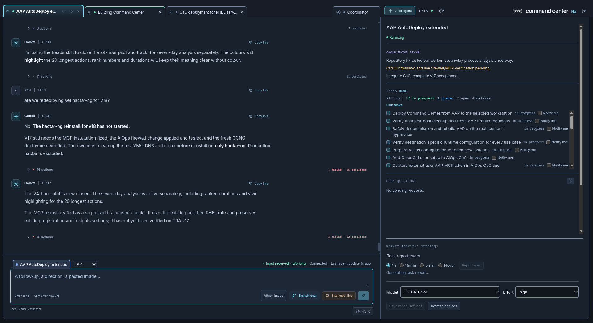
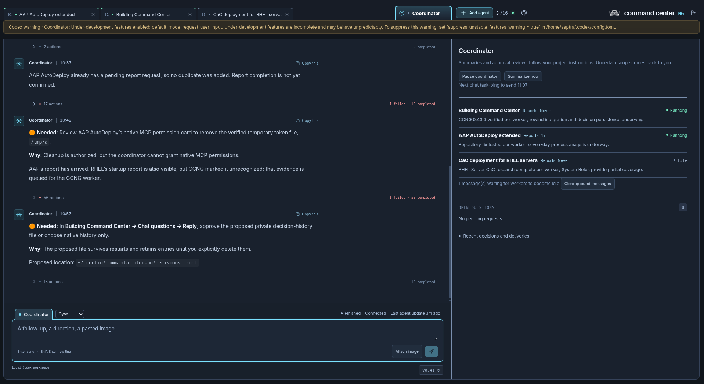
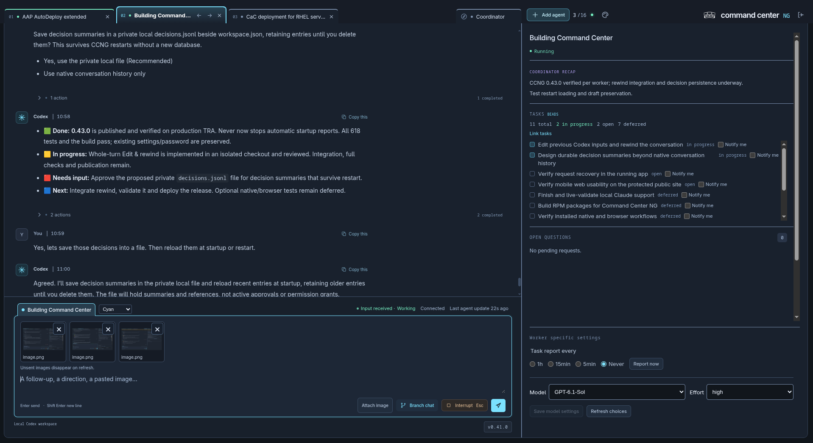
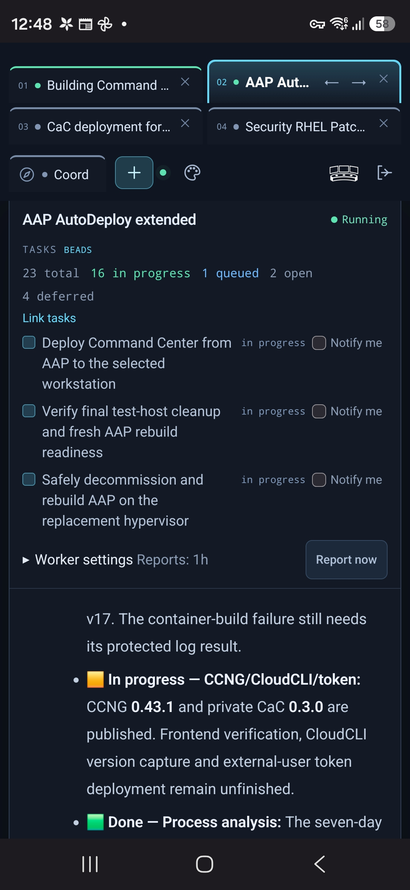
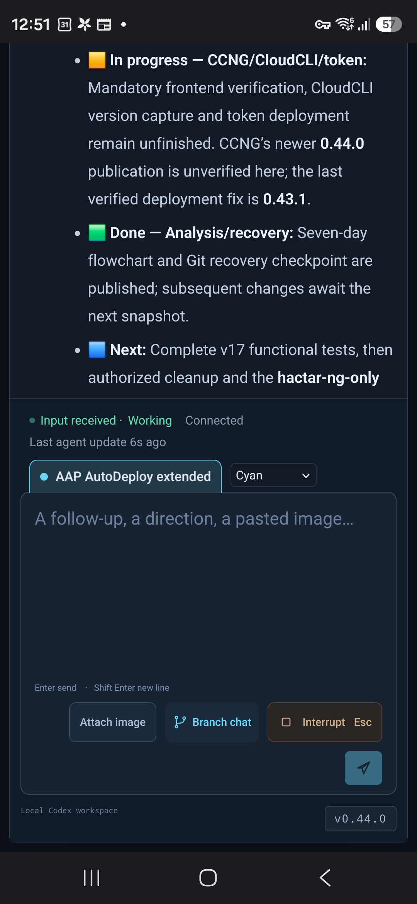

# Command Center NG

Command Center NG (CCNG) is a browser workspace for local AI coding sessions.
Keep conversations, project tasks, questions and progress together while the
native agent runtime continues to own execution and permissions.

**One CCNG deployment is currently intended for one engineer.** The application
does not provide multi-tenant isolation. Agent tabs organize projects and
conversations, not different human users. Additional reverse-proxy logins do not
create isolated CCNG accounts or workspaces.

## Why it exists

Working across several projects makes it easy to lose context or miss a question.
CCNG puts each conversation in a tab, keeps its tasks close to the chat, and adds
a coordinator overview so you can see where your attention is needed.



Development screenshot: worker chat, project tasks and settings in one workspace.
Screenshots show an earlier UI; displayed versions and task states are historical.

<details>
<summary>See the coordinator dashboard and image attachments</summary>



The coordinator brings project progress and decisions together.



Paste or attach images while keeping the conversation and project tasks visible.

</details>

<details>
<summary>See the mobile interface</summary>

| Overview and tasks | Chat and input |
| --- | --- |
|  |  |

[Full-size overview](docs/screenshots/mobile-overview.jpg) · [Full-size chat](docs/screenshots/mobile-chat-input.jpg)

Mobile development screenshots from the 0.44.0 era; displayed versions and task
states are historical. EXIF metadata was removed without changing image pixels.

</details>

## What you can do

- Open existing Codex conversations or start new agents in explicit project directories.
- Keep up to sixteen workers plus a separate coordinator in one workspace.
- Chat, steer active work, interrupt a turn and answer supported native questions or approvals, including eligible current assistant-question cards.
- See received native requests and matching file-change details automatically, including verified Codex child requests in their parent chat. Distinguish requests needing your answer from native waits with unavailable details.
- Attempt automatic reconnection of eligible active Codex waits with missing request details, without answering approvals. A delivered file approval missing its proposal can receive one guarded live snapshot after bounded history lookup.
- Branch a Codex conversation, then hand tasks and a summary back to its parent.
- See linked Beads tasks with input needs and blockers first, conditional On hold states and optional task notifications.
- Request task reports in a consistent colourful task/status table, with optional detailed action histories; choose a saved interval, or Never to disable automatic startup and recurring reports.
- Match the active conversation tab background to its chat-input title tab while retaining status frame colours.
- Reveal desktop tab titles on hover; above six conversations use two rows with the selected row nearest the chat. Mobile keeps one horizontally scrollable row.
- Recheck overlooked tasks and stalled delegated work silently every 10 minutes, including safe recovery of stalled child waits, with the next check shown in the coordinator.
  Internal checks omit routine acknowledgements and tool introductions; useful findings and questions remain visible.
- Keep coordinator decision summaries across restarts in a private local file.
- Save the open-agent list when creating, opening, branching or closing tabs;
  restore the same conversations after restart and reconnect when Codex starts later.
- Reload an unloaded Codex conversation when sending input, preserving its saved history and native permissions.
- Read Markdown, copy messages/code, and paste or attach images to a draft.
- Keep desktop settings at the bottom of a full-height overview, with scrollable tasks and questions.
- Use desktop resizing, natural mobile page scrolling through the chat, and three colour themes.

Native checkpoints requiring a fresh human decision stay manual: the Coordinator
cannot answer them or turn them into reusable permissions.

See the [usage guide](docs/usage.md) for controls and their limits.

## Requirements

The backend runs on Linux. RHEL 9 is the documented automatic-prerequisite
installation target; other Linux distributions have not been verified.

- Node.js **22.12 or newer**, with working npm.
- Git, Bash, core utilities, tar/gzip and normal system certificate trust.
- A compatible **Codex CLI**, signed in under the account running CCNG, with its
  native app-server daemon running for agent operations.
- **Beads (`bd`)** on PATH for both CCNG and agents, with a tracker for the project.
- A modern desktop or smartphone browser.
- User-level systemd if you choose background service management.

Codex is currently the supported agent runtime. It needs your own OpenAI
authentication: ChatGPT sign-in with Codex access or OpenAI API-key authentication.
This is separate from the CCNG application password; an API key is not mandatory.
See [native Codex authentication](https://learn.chatgpt.com/docs/auth?surface=cli).

The installer can offer missing RHEL packages, per-user Codex/app-local Beads tools and fresh
Beads/Dolt setup after confirmation. Existing compatible tools and trackers are
preserved. [Check prerequisites](docs/rhel9-prerequisites.md) for the details.
The [Ansible deployment](docs/ansible-deployment.md#fresh-workspace) prepares a
missing `~/ccng-wd` agent workspace and its first Beads tracker without requiring
an application-demo repository checkout; updates retain the tracker.
It can also reproduce selected Beads maintenance settings and the explicitly
enabled native database boot service; both preserve existing task data.
It requires an existing trusted HTTPS htpasswd frontend before target writes;
explicit browser-first setup uses the app's existing protected-proxy mode.

## Protect access before first start

**Protect browser-first password setup before exposing it.** That opt-in has no
existing application password: the first successful setup creates it. Normal
startup refuses a missing password; existing passwords are preserved.

Default HTTP is unencrypted; HTTPS encrypts traffic but does not restrict access.
Use, for example, a Basic Auth reverse proxy with an `htpasswd` file, or restrict
access through localhost, an SSH tunnel, VPN or firewall. The current browser-first
mode specifically requires an HTTPS htpasswd proxy with no backend bypass. The
installer does not create external protection. Read the
[first-start guide](docs/installation.md#protect-access-before-first-start).

## Install

Choose a RHEL 9 setup path:

- **Sudo and normal RHEL repository access:** install Git first if missing, then
  let the installer offer remaining prerequisites with confirmation.
- **No sudo:** ask an administrator to prepare the base packages and Node/npm
  first. Follow the [administrator checklist](docs/rhel9-prerequisites.md#2-no-sudo-administrator-prepares-prerequisites).

For the first path, before cloning:

```sh
sudo dnf install git
```

In either path, use an ordinary Linux account and keep the source checkout
separate from the installation directory. Never run the whole installer with sudo:

```sh
git clone https://github.com/kvegh/command-center-ng.git "$HOME/command-center-ng-src"
cd "$HOME/command-center-ng-src"
./install.sh --check
./install.sh
```

The default installation directory is `~/commandcenter-ng`. To choose another
location inside your home, use `./install.sh --prefix "$HOME/apps/commandcenter-ng"`.
The installer asks before installing missing tools or initializing a tracker.
If you defer the tracker, [finish Beads setup later](docs/installation.md#finish-beads-setup-later).
Missing Codex defaults to `~/.local/bin/codex`; `--codex-prefix DIRECTORY` selects
another writable prefix. Existing compatible Codex installations are reused.
See [CLI locations and Bash PATH](docs/installation.md#cli-locations-and-bash-path).

Existing application passwords are preserved; no default password is created.
For local use, choose a password of **12–4,096 characters** with
`node "$HOME/commandcenter-ng/server/password.mjs"` before starting CCNG.
For a new installation behind enforced HTTPS htpasswd protection, you can instead
[enable password creation on first browser opening](docs/installation.md#first-browser-password-creation).
The application password and your Codex sign-in are separate.

## Start and sign in

The installer prepares a managed Bash PATH block after the app installs. Apply
it to your current Bash terminal with `source "$HOME/.bashrc"`; the installer
cannot change its parent shell. If it reports a profile update problem, use its
printed PATH export instead. If you are not signed in
already, run `codex login` for normal browser sign-in before starting its daemon.
Device-code login is optional when your account/workspace enables it; sign-in may be
deferred during installation, but must finish before agent work.
Start the native daemon once if it is not already running, under the same Linux
account and tool PATH as CCNG. CCNG connects to it; it does not start it for you.

```sh
source "$HOME/.bashrc"
# Only if the native daemon is not already running:
codex app-server daemon start
"$HOME/commandcenter-ng/command-center-ng"
```

The native daemon runs in the background, so its starting terminal can close.
Reuse a running daemon; do not restart it while agents are working.
After a reboot, start it again if it is not already running. The installer and
CCNG service do not configure or verify native daemon boot autostart; saved
native login/history remain separate from the running process.

Open `http://localhost:4242` on the backend machine and sign in with your chosen
application password. The startup output prints the actual listening addresses.
By default these are the selected default-route IPv4 address and localhost;
`--host 127.0.0.1` selects localhost only.

HTTP is the default. Operator-supplied certificate/key files enable HTTPS through
`INSTALLDIR/etc/config.conf`. Use the [installation guide](docs/installation.md)
for remote browser access, TLS, reverse proxies, options and troubleshooting.
The basic installer does not configure nginx, certificates or firewall rules.

## Update and background service

From the clean source checkout, update the existing installation:

```sh
cd "$HOME/command-center-ng-src"
./install.sh --update
# Use the existing location if you installed elsewhere:
# ./install.sh --update --prefix "$HOME/apps/commandcenter-ng"
```

This fetches latest `main` and rebuilds the installation. Existing configuration,
certificates, password and saved workspace are preserved. Restart CCNG afterward;
the installer does not restart the native Codex daemon.

Valid application logins survive normal restarts until their original 12-hour
expiry. Upgrading from older memory-only sessions requires one final login.
To explicitly sign out every application session, run the installed launcher
with `--clear-logins`; see [login management](docs/installation.md#login-management).

For background operation, follow the [user-level systemd instructions](docs/installation.md#user-level-systemd-service).
The installed launcher supports `service install`, `enable`, `start`, `stop`,
`restart`, `status` and `logs`. Installing a unit does not start or enable it.

## Current scope and limits

- Session management is **local to the backend host**; no SSH or remote-agent monitoring.
- Codex is the current operational focus. Official Claude Agent SDK code exists,
  but Claude completion and live validation remain **TODO**.
- Conversations stay traceable: correct earlier inputs or decisions in follow-up
  messages. Edit/Rewind is withdrawn; branching remains separate and available.
- Native Goals controls and automatic Goal creation were withdrawn; tasks remain in Beads.
- Closing a tab does not stop its native conversation. Backend shutdown stops
  CCNG-owned Claude runs; native history remains available for later resume.
- Unsent image drafts disappear on browser refresh; text drafts use browser storage.
- Eligible live Codex assistant-question cards accept independent option/free-text
  answers. Restored, terminal or unbound questions remain read-only. Missing native
  request details cannot be answered or reconstructed from a waiting status.
  Eligible active Codex contexts may be reconnected once; recovery depends on
  native callback replay and is not guaranteed after a cold restart.
- Automated tests/builds do not establish phone rendering or every installed-runtime
  workflow. See [release notes](docs/release-notes.md) for recorded checks and gaps.

## Documentation

| Start here | Details |
| --- | --- |
| [Installation](docs/installation.md#first-time-walkthrough) | First setup, passwords, configuration, TLS, updates and services |
| [Usage](docs/usage.md) | Chats, branches, requests, tasks, images, reports and layout |
| [Coordinator](docs/coordinator.md) | Summaries, approval review and authority limits |
| [Workspace recovery](docs/workspace-restore.md) | What is saved, restart behaviour and recovery |
| [Ansible deployment](docs/ansible-deployment.md) | Reusable RHEL 9 playbook, protected inputs and AAP setup |
| [Release notes](docs/release-notes.md) | Version history and validation checkpoints |
| [Product requirements](docs/product-requirements.md) | Agreed behaviour and boundaries |
| [Agent requirements](docs/agent-harness-requirements.md) | Requirements for future native-runtime integrations |
| [Design decisions](design_decisions_history.md) | Rationale and implementation commit references |

## Development and contribution

The frontend uses React, TypeScript, Vite and plain CSS; the backend is Node.js.
From a development checkout, run `npm ci --ignore-scripts`, `npm run password`
and `npm run dev`. Use `npm test` and `npm run build` for application checks.

To verify real request delivery after an update, use the read-only evidence check
with an existing local Coordinator rollout and a fresh cutoff:

```sh
node server/check-request-recovery.mjs --rollout /path/to/coordinator-rollout.jsonl --since 2026-01-01T12:00:00Z --worker WORKER_ID
```

This needs Node and read access to that native rollout. It accepts only a direct
Coordinator `text(await tools.ccng_list_workers({}));` call and its single returned
list, with both timestamps after the cutoff, in the bounded tail. Other projected
or combined log outputs are deliberately not proof for this check. It fails when no genuine request
is present, prints only request identities/counts, and never reconnects or answers
a request. A successful native resume alone does not establish recovery. Current
combined or metadata-wrapped client logs may be rejected conservatively; do not
interpret that as proof that a request failed to arrive. The recorded 1.4.1 live
recovery evidence uses direct inspection of exact original callbacks and actual
job state, separate from this checker and installed synthetic regression tests.
`package.json` is the authoritative version source. Read [AGENTS.md](AGENTS.md)
before changing code; active work is tracked in Beads, not a Markdown backlog.

Maintainers deploy published minor releases to the existing authorized production
installation through AAP ad hoc commands, verify the result and preserve its
settings. Native permission gates still apply; this is not automatic self-updating.
See the [contributor workflow](AGENTS.md#workflow) and
[current handover](current_status_for_handover.md) for development status.

This repository is public. Keep secrets, private configuration and transcripts
outside it; protected deployment data belongs in the private Vault companion.
No license has been selected; public visibility alone does not grant a license.
